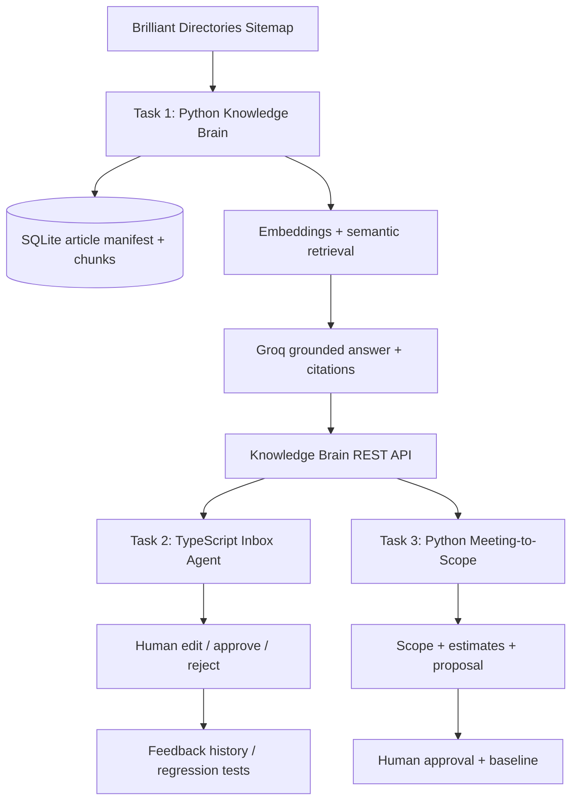

# Design — AI Tech Consultant

## Problem and users
Small software/service businesses lose time searching product documentation, replying to recurring customer emails, and translating loosely defined meetings into estimates and proposals. The product gives support staff and consultants a grounded assistant while retaining human control over risky decisions.

## Architecture

## Why a shared Knowledge Brain
The help center is a shared source of truth. Both downstream applications use its API so citations, updates, abstention, and escalation behavior are consistent. A failed or insufficient knowledge lookup must not be converted into an invented product fact.

## Task responsibilities
- **Knowledge Brain:** sitemap crawl, polite rate limiting, retries, manifest, article parsing, chunk embeddings, retrieval, Groq answers, citations and escalation.
- **Inbox Agent:** typed email input, category/risk, Knowledge API call, structured draft, reviewer actions, feedback log, consecutive unchanged approval counter. The prototype only reports autonomy eligibility; it does not send email automatically.
- **Meeting to Scope:** transcript analysis, requirements with source quotes, Knowledge API feasibility checks, task estimates, scope/proposal, follow-up comparison and approval.

## Data and model choices
The prototype stores article metadata, chunks and escalations in SQLite. Text chunks use `sentence-transformers/all-MiniLM-L6-v2` embeddings and cosine similarity. Groq is the central generation model, configurable with `GROQ_MODEL`. These are initial choices, not proven optimal choices. Evaluate at least two available Groq configurations on the same frozen test set and report quality, cost and latency.

## Human control and safety
Refunds, commercial quotes, complaints, security-sensitive issues, and unclear product behavior should remain under human review. No email or proposal is actually sent to an external client. A follow-up must be compared to an approved baseline, not a previous unapproved draft.

## Limitations / next work
1. Complete and test screenshot understanding with a vision-capable Groq call; attach descriptions to article/chunk metadata and show image references in the UI.
2. Persist Task 2 drafts and feedback in a database rather than process memory.
3. Add a durable task queue, resumable crawl checkpoints per URL, scheduled daily ingestion, and admin controls.
4. Add robust schema validation/retries and model-call observability.
5. Add authentication, authorization, rate limiting, privacy controls and audit history.
6. Build 20+ manually labelled evaluations per task and model comparison; do not report unmeasured numbers.
7. Add tests for API outage, malformed JSON, missing evidence, article removal, and approval gates.
